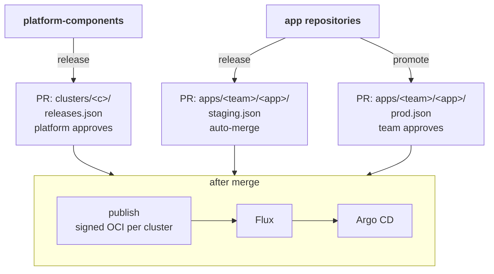

# gitops

What runs where, for [`homelab-selfuryon`](https://github.com/homelab-selfuryon). The repository
holds only data and a small CUE render:

- the digest of the platform release per cluster (`clusters/<cluster>/releases.json`: one artifact, a directory per set),
- digests of app manifests per environment (`apps/<team>/<app>/{staging,prod}.json`),
- the org's apps and teams (`catalog.json`, generated by the [`catalog`](https://github.com/homelab-selfuryon/catalog) repository),
- the render from that data to Flux `OCIRepository`/`Kustomization` and Argo CD
  `Application`/`ApplicationSet` objects.

On merge to `main` the render is pushed per cluster as a signed OCI artifact (`.github/workflows/publish.yaml`, signed in that job itself so the certificate subject is `gitops/.github/workflows/publish.yaml@refs/heads/main`)
(`ghcr.io/homelab-selfuryon/gitops/<cluster>:main`); Flux pulls it with cosign verification. Argo CD
has no git access at all.



Rollback is a revert of the PR. The design is in `meta/delivery.md` (gitops layout, Flux object names).

## Layout

```
cue.mod/                         module github.com/homelab-selfuryon/gitops@v0, language v0.18.0 (no dependencies)
schema/                          #Cluster, #App, #Version, #Render (data -> objects)
catalog.json                     teams and apps, from the `catalog` repository (never edited here)
registry.cue                     clusters (one import each); apps built from catalog.json + version files
ext_tool.cue                     `cue cmd render`
clusters/<c>/cluster.cue         name, set order
clusters/<c>/releases.json       {"version": "<hash>", "digest": "sha256:..."}  (the platform artifact)
apps/<team>/<app>/staging.json   {"version": "v1.2.0", "digest": "sha256:..."}
apps/<team>/<app>/prod.json      same shape
devenv.nix, devenv.yaml, devenv.lock   cue v0.18.0, kubeconform, kyverno, ...; treefmt + hooks
scripts/                         gitops_checks.py (+ tests), test-render.sh, check-components-contract.sh
.github/chainguard/              octo-sts trust policies
.github/workflows/               verify (PR), publish (main), update (weekly devenv update)
```

`{}` means "not released yet": a cluster without a platform release gets no set objects, an app
environment without a digest gets no Application. The repository starts out like that.

## What `cue cmd render` produces

`out/<cluster>/flux/`: one `OCIRepository` `platform-components` (`<cluster>` artifact by digest, cosign
verification: subject `platform-components/.github/workflows/release.yaml@refs/heads/main`, `layerSelector` on the tar+gzip layer) and
a `Kustomization` `set-<set>` per set (path `./<set>/flux`, `wait: true`, ServiceAccount `gitops-root`, `dependsOn`
the previous set); the `argo-apps` Kustomization (path `./argo` of the `gitops` artifact,
ServiceAccount `argo-apps`, `dependsOn: set-tenants`).
`out/<cluster>/argo/`: an `Application` per app and environment it has in `envs` (catalog) and that is released (project `<team>`, source
`oci://ghcr.io/homelab-selfuryon/<app>/manifests` at the digest, path `<env>`, destination namespace
`<team>-<env>`, automated sync with prune and self-heal) and an `ApplicationSet` per app with
`preview` in `envs` (pull request generator, project `<team>-preview`, revision `pr-<n>`, namespace
`<team>-pr-<n>` created with labels `team` and `env`). Each directory has a `kustomization.yaml`.

Argo CD OCI sources (checked against the Argo CD docs): `repoURL` takes the `oci://` scheme,
`targetRevision` a tag or a digest, `path` a directory inside the single tar+gzip layer. Public
GHCR packages need no repository registration; private ones need a repository of type `oci`.

## Adding things

- An app: add it to the `catalog` repository. Its fan-out opens a `catalog/sync` PR here with the
  new `catalog.json` and what `scripts/gitops_checks.py sync` derives from it: `{}` version files
  under `apps/<team>/<app>/` and the team's `prod.json` line in the generated CODEOWNERS block.
  The `app-release`/`app-promote` identities already match (`repo:homelab-selfuryon@353728095/<app>@<id>`).
- A cluster: `clusters/<c>/{cluster.cue,releases.json}` and an import in `registry.cue`.

## Checks

`.github/workflows/verify.yaml` (this repository's own workflow, job `gitops verify`) runs on every PR: who changed what, layout,
`cue fmt`/`vet`/`render`, kubeconform, signature and identity of every referenced artifact (platform: platform-components release.yaml on main; app releases: github-workflows + the `refs/tags/<version>` ref), Kyverno,
object diff as a comment. A release PR from the bot may touch exactly one version file
(`scripts/gitops_checks.py`, taken from the base branch). Locally:

```
devenv shell                                   # direnv: .envrc
devenv test            # treefmt, cue vet, unit tests, render with sample digests, shellcheck
bash scripts/check-components-contract.sh <platform-components>/out/<cluster> <cluster>
```

License: Apache-2.0.

## Where apps come from

`catalog.json` (the `catalog` repository's output, the same file platform-terraform and
platform-components read). `registry.cue` builds `apps` from it and embeds every version file
(`@embed(glob=...)`), so no file here names an app by hand. `gitops_checks.py layout` makes sure
`apps/` and the CODEOWNERS block match the catalog; `sync` makes them match. When `catalog.json`
changes, `gitops-verify` checks every app's team against its repository's `owner-team` property:
platform-terraform applies the catalog first. Platform approves (CODEOWNERS).

## Updating the tools

`update.yaml` runs `devenv update` weekly and opens a PR (octo-sts identity `devenv-update`, policy in
`.github/chainguard/`), because Renovate has no devenv manager. Renovate config: `.github/renovate.json`.
